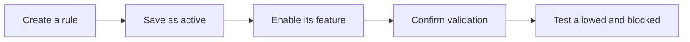

{/* Screenshot plan M04: M04-01-规则列表已启用.png; M04-02-选择指定产品.png; M04-03-选择产品系列.png */}

Order Limit checks applicable cart items and customer conditions. Before creating a rule, decide which items it covers, which customers it applies to, and when it should run.

## Key terms

| Term | Cup example |
| --- | --- |
| Product | One cup design |
| Variant | Its red, blue or size options |
| Collection | A promotional group of cups, coasters and other products |
| Individual | Each product has its own allowance; its variants count together |
| Combined | All matching items share one threshold |
| Customer tag | A label such as VIP in a Shopify customer profile |
| Cumulative purchases | Recorded product purchases for one customer, separate from the current cart |

## Check three levels of activation

| Level | What to check |
| --- | --- |
| Rule | **Active**, rather than **Draft** |
| Feature | The switch for the corresponding rule category is on |
| Validation | Quantity validation is enabled; other categories show no saving or activation error |

Product/variant limits and quantity rules are separate settings. Enable product quantity limits for values edited in the product table. Enable quantity rules for rules created in the rule editor.

## Choose the product scope

- **All products** checks all cart products.
- **Specific products** checks the products you select.
- **Collections** matches current collection membership. Products added to a collection later also match.

Cumulative purchase rules support all products or selected products, but not collections.

## A minimum does not force an unrelated purchase

For a selected product or collection, a minimum applies only when the cart contains a matching item. A coffee collection minimum does not require someone buying only a mug to add coffee.

## Choose when to check

Select **Cart interactions and checkout** or **Checkout only**. Quantity minimums are checked at checkout, allowing customers to add items one at a time. Test the actual cart and checkout presentation in your theme.

<Warning>A cart must satisfy every applicable rule category. Check that quantity, amount, weight and customer eligibility conditions leave a valid purchase path.</Warning>

## Find the settings in the app

Labels in this English guide are translated for readability. The current source app uses Chinese labels. Use this reference to find the corresponding settings; it does not promise an English app interface.

| English term in this guide | Chinese app label |
| --- | --- |
| Order Limit | 订单限购 |
| Quantity limits / All quantity rules | 数量限制 / 所有数量规则 |
| Customer tag quantity rules / Cumulative purchase rules | 客户标签数量规则 / 客户累计规则 |
| Price rules / Weight rules / Customer restriction rules | 价格规则 / 重量规则 / 客户限制规则 |
| Cart quantity limit | 购物车数量限制 |
| Limit each applicable item individually | 分别限制每个适用商品 |
| Limit the combined cart quantity of applicable items | 限制购物车内适用商品的加购数量合计 |
| All products / Specific products / Collections | 所有产品 / 指定产品 / 产品系列 |
| Customer tags / Add tag | 客户标签 / 添加标签 |
| Active / Draft / Create and activate / Save and activate | 已启用 / 草稿 / 创建并启用 / 保存并启用 |
| Enable quantity rules | **数量规则** → **已开启** |
| Configure messages / Save | 配置提示文案 / 保存 |
| Require a customer account sign-in | 需要客户账户登录 |

Read [rule priority](/en/settings/rule-priority) before combining rules.

## How a rule becomes active

Unsure which type to choose? Use [About Order Limit](/en/index). For pausing, restoring and test records, use the [launch checklist](/en/getting-started/launch-checklist).
