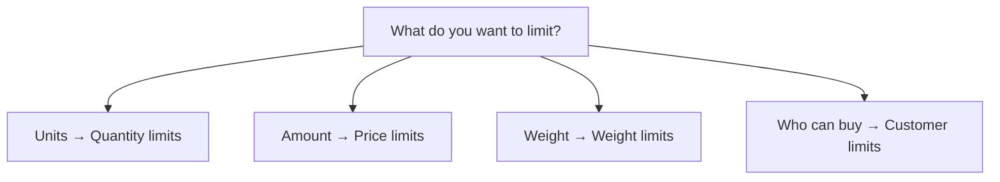

{/* Screenshot plan M01: M01-01-应用首页入口.png */}

Use Order Limit to control how much customers can buy and who can purchase selected products. Choose a business scenario, follow its settings, and test both allowed and blocked carts.

## Four limit types at a glance

## How the main features differ

The Chinese names below match the app sidebar. Choose a feature based on whether you need to check units, amount, weight or purchase eligibility.

| App feature | What it checks | Available settings | Example and distinction |
| --- | --- | --- | --- |
| [Quantity limits](/en/features/quantity) (**数量限制**) | Number of units purchased | Product or variant quantities; individual or combined rules; different allowances by customer tag | At least 6 of each product, or up to 3 across products. Controls how many units a customer can buy, rather than purchase eligibility |
| [Price limits](/en/features/price) (**价格限制**) | Current total amount of applicable merchandise | Minimum, maximum or amount range; different thresholds by customer tag | Require a merchandise amount of at least 100. Checks amounts without changing prices or providing discounts |
| [Weight limits](/en/features/weight) (**重量限制**) | Total applicable merchandise weight, using variant unit weight multiplied by quantity | Minimum, maximum or weight range; different thresholds by customer tag | Keep merchandise within 20 kg. Does not calculate shipping fees or split packages |
| [Customer limits](/en/features/customer) (**客户限制**) | Whether a customer can buy applicable products | Allow or block by customer tag, or require sign-in | Only VIPs can buy, or buyers must sign in. Does not set unit allowances or hide product pages |

**Cumulative customer rules** (**客户累计规则**) belong to **Quantity limits**, rather than a fifth limit type. They check repeat purchases against recorded customer quantities. Per-order and cumulative limits differ; first purchases need a separate single-order cap. See [cumulative customer rules](/en/features/purchase-history).

To let VIPs buy up to 4 units per order, use a customer-tag rule under **Quantity limits**. To let only VIPs buy, use **Customer limits**. You can combine both to control eligibility and quantity.

## First time here?

1. [Choose a rule](/en/getting-started/choose-rule) to define products, customers and calculation.
2. [Create your first rule](/en/quickstart) with a test product capped at 2 units.
3. [Test before launch](/en/getting-started/launch-checklist) with both allowed and blocked carts.

<Columns cols={2}>
<Card title="Create your first rule" href="/en/quickstart">Limit a test product to 2 units per cart and verify checkout.</Card>
<Card title="Browse business scenarios" href="/en/scenarios/index">Limited releases, wholesale minimums, member exclusives and repeat purchases.</Card>
</Columns>

## What do you want to do?

| Goal | Guide |
| --- | --- |
| Limit a new product to 2 units per order | [Limited release](/en/scenarios/limited-release) |
| Allow up to 3 units across a collection | [Mix and match](/en/scenarios/mix-and-match) |
| Require at least 6 units of each product | [Wholesale minimum](/en/scenarios/wholesale-minimum) |
| Give VIPs a larger purchase allowance | [Customer quantity limits](/en/scenarios/vip-quantity) |
| Require a minimum merchandise amount of 100 | [Minimum order value](/en/scenarios/minimum-order-value) |
| Use different amount thresholds for customer groups | [Customer pricing rules](/en/scenarios/customer-pricing) |
| Keep merchandise weight within 20 kg | [Weight cap](/en/scenarios/shipping-weight) |
| Sell a collection only to VIPs | [Member exclusives](/en/scenarios/members-only) |
| Block tagged customers from promotional products | [Block selected customers](/en/scenarios/block-customers) |
| Restrict a customer's repeat sample purchase | [Repeat purchase limits](/en/scenarios/repeat-purchase) |
| Blue variant maximum 1, product total maximum 3 | [Product and variant setup](/en/getting-started/product-variant-limits) |
| Require sign-in for selected products | [Require sign-in](/en/scenarios/login-required) |

## Understand the features

<Columns cols={2}>
<Card title="Quantity limits" href="/en/features/quantity">Products, variants, individual and combined quantities.</Card>
<Card title="Price limits" href="/en/features/price">Merchandise amounts, product scope and currency conversion.</Card>
<Card title="Weight limits" href="/en/features/weight">Variant weights, quantities and unit conversion.</Card>
<Card title="Customer limits" href="/en/features/customer">Customer tags and account sign-in requirements.</Card>
</Columns>

<Note>Product names, tags and thresholds in these guides are examples. Replace them with your own settings. The documentation is translated; this does not imply the app interface is available in every documentation language. See the [Chinese UI label reference](/en/getting-started/how-it-works#find-the-settings-in-the-app).</Note>
