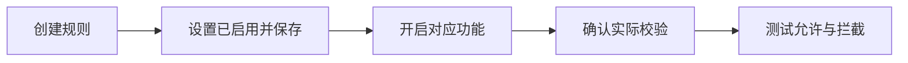

{/* Screenshot plan M04: M04-01-规则列表已启用.png; M04-02-选择指定产品.png; M04-03-选择产品系列.png */}

订单限制会根据购物车中的适用商品和客户条件判断是否允许继续购买。创建规则前，先确认你限制的是哪一部分商品、哪一类客户，以及在哪个阶段检查。

## 先认识这些词

| 术语 | 用产品举例 |
| --- | --- |
| 产品 | 一款产品 |
| 变体 | 产品的变体 A、变体 B或不同容量 |
| 产品系列 | 把产品、杯垫等多个产品归到同一个促销范围 |
| 分别计算 | 每款产品各有自己的数量门槛；同款变体合计 |
| 合计计算 | 这条规则命中的所有商品共用一个门槛 |
| 客户标签 | Shopify 客户资料中的分类标记，如 VIP |
| 累计购买 | 同一客户已记录的产品购买量，区别于本次购物车数量 |

## 三个需要分别确认的状态

| 层级 | 你需要检查什么 |
| --- | --- |
| 单条规则 | 规则状态是 **已启用**，而不是 **草稿** |
| 功能开关 | 对应类别的规则开关已开启 |
| 实际校验 | 数量限制中的 **数量规则** 显示 **已开启**；其他类别开启后没有保存或启用错误 |

数量限制中的 **产品 / 变体数量限制** 与 **数量规则** 是两个独立开关。你在产品表格中设置限制时，需要开启产品数量限制；你通过规则编辑器创建规则时，需要数量规则。

## 选择适用商品

- **所有产品**：对购物车中的所有产品应用规则。
- **指定产品**：只检查你选择的产品。
- **产品系列**：根据商品当前所属产品系列匹配。以后加入该产品系列的产品也会适用。

客户累计购买限制仅支持所有产品或指定产品，不支持产品系列。

## 没买某个商品，是否必须加购？

对指定产品或产品系列设置最低门槛，不会强制顾客购买这个范围的商品。购物车中出现适用商品后，才检查该范围的门槛。例如指定咖啡豆产品系列最低金额 100，购物车只有杯子时，这条规则不会要求顾客补买咖啡豆。

## 在哪里显示限制

选择 **购物车互动时和结账时**，或 **仅结账时**。数量最低门槛只在结账阶段检查，让顾客先逐件加购到起订量。前台提示的展示方式取决于实际购物车和结账体验，请测试你的主题。

<Warning>规则通过不代表整笔订单一定能完成。多类规则可能同时检查同一个购物车。请检查数量、金额、重量和客户资格是否相互冲突。</Warning>

继续阅读：[多条规则的优先级](/settings/rule-priority)。

## 规则生效需要什么

不确定选哪种类型？先看[了解订单限制](/index)。需要暂停、恢复或记录测试？看[上线测试清单](/getting-started/launch-checklist)。
