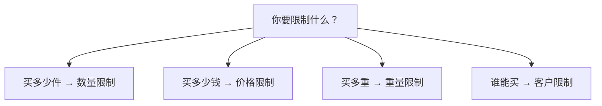

{/* Screenshot plan M01: M01-01-应用首页入口.png */}

用订单限购管理一次购买的数量、适用商品的金额和重量，以及哪些客户可以购买。先选一个与你的业务相近的场景，再按步骤完成设置和测试。

## 用一张图分清四类限制

## 主要功能有什么区别？

下表功能名称与 App 侧边栏一致。先看你要检查的是件数、金额、重量还是购买资格，再进入对应功能。

| App 功能 | 检查什么 | 可以怎样设置 | 示例与区别 |
| --- | --- | --- | --- |
| [数量限制](/features/quantity) | 购买的件数 | 按产品或变体设置数量；用规则分别计算或合计数量；按客户标签设置不同额度 | 每款至少 6 件，或多款合计最多 3 件。控制能买多少件，不决定谁有资格买 |
| [价格限制](/features/price) | 适用商品的当前金额合计 | 设置最低金额、最高金额或金额范围；按客户标签设置不同门槛 | 商品金额至少 100 才能结账。检查金额，不修改售价或提供折扣 |
| [重量限制](/features/weight) | 适用商品的重量合计，按变体单件重量乘以数量 | 设置最低重量、最高重量或重量范围；按客户标签设置不同门槛 | 商品合计不超过 20 kg。检查商品重量，不计算运费或自动拆包 |
| [客户限制](/features/customer) | 客户能否购买适用商品 | 按客户标签允许或禁止购买，或要求登录 | 只有 VIP 能买，或登录后才能买。不设置购买件数，也不隐藏商品页面 |

**客户累计规则**属于**数量限制**，不是第五类限制。它结合客户已记录的购买数量检查再次购买；每单限购与累计限购不同，首次购买上限需要另设单次规则。详见[客户累计规则](/features/purchase-history)。

例如，VIP 每单最多买 4 件，用**数量限制**按客户标签设置额度；只有 VIP 可以购买，用**客户限制**设置资格。你可以组合两类规则，同时限制谁能买和能买多少。

## 第一次使用，从这里开始

1. [选对限制方案](/getting-started/choose-rule)：先明确商品范围、客户条件和计算口径。
2. [创建第一条规则](/quickstart)：用测试产品设置每单最多 2 件。
3. [验证并上线](/getting-started/launch-checklist)：测试通过和拦截，再应用到正式商品。

<Columns cols={2}>
  <Card title="创建第一条限购规则" href="/quickstart">从指定商品每单最多购买 2 件开始，完成启用和结账测试。</Card>
  <Card title="按经营场景查找" href="/scenarios/index">限量发售、批发起订、会员专享、混合商品限购。</Card>
</Columns>

## 你想解决什么问题？

| 经营目标 | 推荐配置 |
| --- | --- |
| 热门新品每单最多买 2 件 | [单品限购](/scenarios/limited-release) |
| 一个产品系列任选，合计最多 3 件 | [产品系列混合限购](/scenarios/mix-and-match) |
| 每种产品至少购买 6 件 | [批发起订量](/scenarios/wholesale-minimum) |
| VIP 最多买 4 件，其他客户最多买 2 件 | [客户分组限购](/scenarios/vip-quantity) |
| 商品金额满 100 才能结账 | [最低消费](/scenarios/minimum-order-value) |
| 批发和零售客户使用不同金额门槛 | [客户分组金额](/scenarios/customer-pricing) |
| 一单商品重量不超过 20 kg | [重量上限](/scenarios/shipping-weight) |
| 只有 VIP 能购买专属产品系列 | [会员专享](/scenarios/members-only) |
| 特定标签客户不能购买促销商品 | [限制指定客户](/scenarios/block-customers) |
| 限制同一客户再次购买样品 | [重复购买限制](/scenarios/repeat-purchase) |
| 蓝色最多 1 件、整款产品合计最多 3 件 | [产品与变体设置](/getting-started/product-variant-limits) |
| 指定商品要求登录后购买 | [登录后购买](/scenarios/login-required) |

## 了解规则如何工作

<Columns cols={2}>
  <Card title="数量限制" href="/features/quantity">产品与变体、分别计算与合计计算、规则优先级。</Card>
  <Card title="价格限制" href="/features/price">最低和最高金额、适用商品、市场货币换算。</Card>
  <Card title="重量限制" href="/features/weight">变体重量、单位换算和适用商品的合计重量。</Card>
  <Card title="客户限制" href="/features/customer">按客户标签限制购买，并要求客户登录。</Card>
</Columns>

<Note>手册中的商品名、客户标签和数值都是配置示例。请替换为你的实际商品与经营门槛。每次修改后，先在店铺前台完成测试。</Note>
