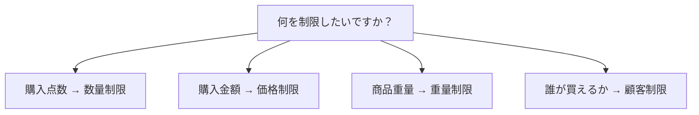

{/* Screenshot plan M01: M01-01-应用首页入口.png */}

Order Limit を使うと、購入数量や対象商品の金額・重量、購入できる顧客を制限できます。運営に近いシナリオを選び、設定後に購入できるカートと制限されるカートを確認してください。

## 図で分かる 4 種類の制限

## 主な機能の違い

下表の中国語名はアプリのサイドバーと一致します。点数、金額、重量、購入資格のどれを確認するかで機能を選んでください。

| アプリの機能 | 確認する対象 | 設定できる内容 | 例と違い |
| --- | --- | --- | --- |
| [数量制限](/ja/features/quantity)（**数量限制**） | 購入する点数 | 商品・バリエーション別の数量、個別・合計ルール、顧客タグ別の購入枠 | 各商品を最低 6 点、または複数商品を合計 3 点まで。購入資格ではなく購入点数を制限します |
| [価格制限](/ja/features/price)（**价格限制**） | 対象商品の現在の合計金額 | 最低金額、最高金額、金額範囲、顧客タグ別の条件 | 商品金額が最低 100 に達した場合に購入を許可。価格変更や割引の機能ではありません |
| [重量制限](/ja/features/weight)（**重量限制**） | バリエーションの単品重量に数量を掛けた対象商品の合計重量 | 最低重量、最高重量、重量範囲、顧客タグ別の条件 | 商品の合計を 20 kg 以内に制限。送料計算や自動的な梱包分割は行いません |
| [顧客制限](/ja/features/customer)（**客户限制**） | 対象商品を購入できる顧客かどうか | 顧客タグによる許可・拒否、ログイン要求 | VIP のみ購入可能、またはログイン必須。購入点数の設定や商品ページの非表示は行いません |

**顧客累計ルール**（**客户累计规则**）は**数量制限**の機能であり、5 種類目の制限ではありません。記録済みの購入数量を使って再購入を確認します。注文ごとの制限と累計制限は異なり、初回購入には別途単回上限が必要です。[顧客累計ルール](/ja/features/purchase-history)を参照してください。

VIP の購入上限を 1 注文につき 4 点にする場合は、**数量制限**で顧客タグ別の購入枠を設定します。VIP のみ購入可能にする場合は、**顧客制限**で資格を設定します。両方を組み合わせて、購入資格と購入点数を制限できます。

## 初めて使う場合

1. [ルールを選ぶ](/ja/getting-started/choose-rule)：商品、顧客、計算方法を決めます。
2. [最初のルールを作る](/ja/quickstart)：テスト商品を最大 2 点にします。
3. [公開前に確認する](/ja/getting-started/launch-checklist)：許可と制限の両方をテストします。

<Columns cols={2}>
<Card title="最初のルールを作成" href="/ja/quickstart">テスト商品をカートごとに 2 点までに制限し、チェックアウトで確認します。</Card>
<Card title="シナリオから探す" href="/ja/scenarios/index">限定販売、卸売の最低数量、会員限定商品、再購入の制限。</Card>
</Columns>

## 何を設定しますか？

| 目的 | ガイド |
| --- | --- |
| 新商品を 1 注文につき 2 点までにする | [限定商品の数量制限](/ja/scenarios/limited-release) |
| コレクション内の商品を合計 3 点までにする | [組み合わせ購入](/ja/scenarios/mix-and-match) |
| 商品ごとに最低 6 点を購入条件にする | [卸売の最低数量](/ja/scenarios/wholesale-minimum) |
| VIP と一般顧客で購入上限を変える | [顧客グループ別の数量](/ja/scenarios/vip-quantity) |
| 商品金額が 100 以上のときだけ購入を許可する | [最低購入金額](/ja/scenarios/minimum-order-value) |
| 卸売と小売で最低金額を変える | [グループ別の金額](/ja/scenarios/customer-pricing) |
| 商品の合計重量を 20 kg 以内にする | [重量の上限](/ja/scenarios/shipping-weight) |
| VIP だけが買える商品を用意する | [会員限定商品](/ja/scenarios/members-only) |
| 特定タグの顧客にセール商品の購入を許可しない | [特定顧客の制限](/ja/scenarios/block-customers) |
| 同じサンプルの再購入を制限する | [再購入制限](/ja/scenarios/repeat-purchase) |
| 青は最大 1 点、商品合計は最大 3 点 | [商品とバリエーション](/ja/getting-started/product-variant-limits) |
| 指定商品の購入にログインを要求 | [ログイン必須](/ja/scenarios/login-required) |

## 機能を理解する

<Columns cols={2}>
<Card title="数量制限" href="/ja/features/quantity">商品・バリエーション単位の数量と合計数量。</Card>
<Card title="価格制限" href="/ja/features/price">対象商品の現在の金額、適用範囲、通貨換算。</Card>
<Card title="重量制限" href="/ja/features/weight">バリエーションの重量、購入数量、単位換算。</Card>
<Card title="顧客制限" href="/ja/features/customer">顧客タグによる購入資格とログイン要件。</Card>
</Columns>

<Note>商品名、タグ、数値は設定例です。ストアに合わせて変更してください。ドキュメントの対応言語とアプリ画面の対応言語は同じとは限りません。[中国語の画面項目との対応](/ja/getting-started/how-it-works#アプリ画面の項目を確認する)も参照してください。</Note>
